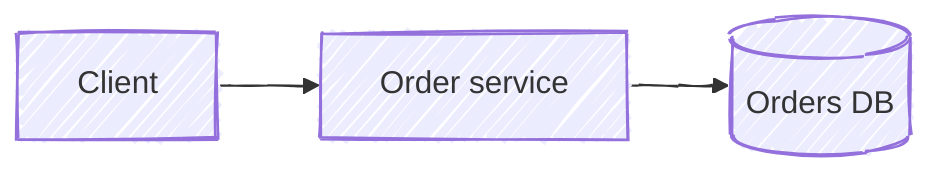

# Diagram kinds

How each kind of technical diagram is laid out with the helpers. Pick the kind from what the reader must understand, not from what the system has: a diagram answers one question.

| The reader must understand | Kind |
|---|---|
| What the parts are and which may talk to which; where the trust or network boundaries are | Architecture with zones |
| What happens to one request or one piece of data, step by step, across components | Request or data flow |
| Who sends what to whom, in what order, including replies and failures | Sequence |
| Which states something passes through and what moves it between them | Lifecycle or state machine |
| Several of the above about one system | A set: an overview plus one detail diagram per topic |

## Architecture with zones

The layout of [`examples/zones-architecture.html`](../examples/zones-architecture.html).

- Columns left to right in the direction requests travel: callers → entry → control → execution → exit → outside. Each column that is a boundary in the text is a `frame()`, labelled with its name and, when the diagram has numbered rules, the rule's circled number.
- A zone that sits beside the flow rather than on it (persistent data, shared storage, observability) goes in its own frame under or above the column that uses it most, with vertical arrows into it.
- The main subject (usually the control plane or the core service) is the tallest box, in `C.agent`, with `strokeWidth: 3`.
- Arrows between zones run through the corridors between frames; a dependency that skips zones goes around the outside with `route()` and says so in its label (`calls the gateway directly, never via a sandbox`).
- Denied paths end in a red hexagon (`Default deny`) with a red dashed arrow and a label naming what is denied.
- When the figure states rules or guarantees, put them in `notes()` under the diagram, numbered to match the circled numbers on the zones and arrows. The rules are the point of such a figure; the drawing shows where each one applies.
- Canvas around 2400–3000 × 1400–1900 for an overview with notes; it is read zoomed in or full screen. Render it with `--scale 1` while iterating; the default 2x output is 5000px or more wide.

## Request or data flow

- One main path, left to right (or top to bottom when it is long), numbered ① ② ③ on the arrow labels in the order things happen.
- Branches for failure or retry leave the main path downward in red dashed lines and come back with a `route()`; they do not cross the main path.
- Label each arrow with what moves (`order`, `INSERT`, `event`) or the call (`POST /orders`). One verb per arrow.
- Components the request never touches stay out, even if they exist.

## Sequence

The layout of [`examples/sequence.html`](../examples/sequence.html).

- One `lifeline()` per participant, in the order they first appear; the initiator on the left. The participant's color follows its role in the binding; the main subject gets a wider box with `box: { strokeWidth: 3 }`.
- Messages top to bottom with `msg()`, about 64px apart, 86px after a self-call. Calls solid, replies `{ reply: true }`, failures `{ error: true }`. Number the steps.
- Message labels name the call and its key arguments (`POST /token (code, verifier)`), not prose.
- Alternatives (a failure instead of the success reply) go right after the message they replace, in red. When one message has more than two alternatives, or the failures need steps of their own, draw them as a separate sequence.
- Notes under a sequence may explain outcomes that span several steps (exit codes, cleanup); such a note names the steps in its body instead of carrying a circled number of its own.
- Width about 440px per participant; height is `top + 140 + 64 × messages + 22 × self-calls`, plus the notes under it. Tighten `H` after looking at the first render.

## Lifecycle or state machine

- States are boxes in the color of the thing whose state it is; the initial state on the left, end states as hexagons on the right (failure end states in `C.error`).
- Transitions are arrows labelled `event [guard] / action`, as short as the text allows. Self-transitions use `route()` loops above the box.
- When time matters (timeouts, idle reclaim), put a `timeline()` under the states with the durations on its ticks.

## A set: overview and details

The layout of [`examples/vertical-search/`](../examples/vertical-search/diagram-binding.md).

- Write the binding file first ([`assets/diagram-binding.md`](../assets/diagram-binding.md)): every concept of the whole set → color → shape, before drawing the first diagram.
- The overview shows each subsystem as one box; each detail diagram expands one subsystem into its parts inside a frame of the subsystem's color, with the rest of the overview reduced to the few boxes it talks to.
- Keep names identical across the set: a box called `Egress proxy` in the overview is `Egress proxy` in its detail, not `Outbound gateway`.

## When Mermaid is enough

Write a Mermaid block instead when the figure goes into Markdown that renders Mermaid, has no zones, numbered rules or bilingual labels, and fits in about ten nodes. Give it the hand-drawn look so it matches these figures:

````markdown

````
